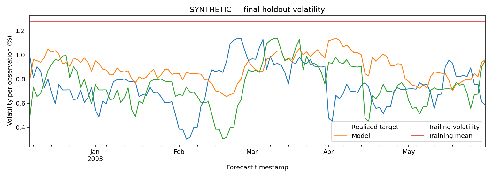
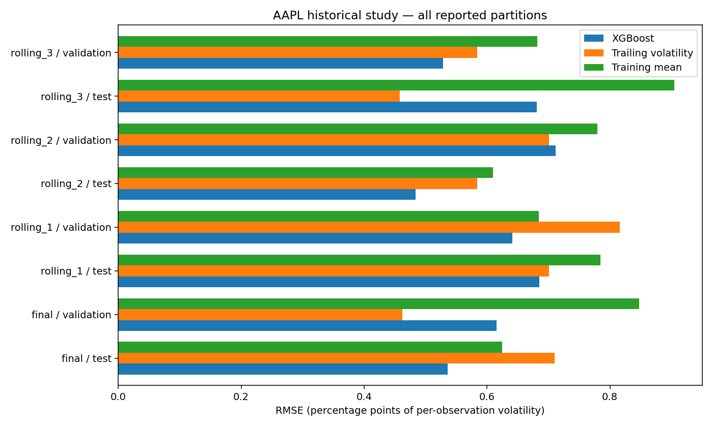

# Temporal Volatility Lab

**Reproducible volatility forecasting with strict temporal validation.**

This project demonstrates explicit forward labels, availability checks, purged
train/validation/test splits, preprocessing inside each fold, simple reference
forecasts and versioned evidence. The repository name retains its original
spelling; the current model forecasts one asset, not a portfolio.

The public demo runs offline on clearly labelled synthetic prices. A frozen AAPL
study retains **all mixed outcomes**. Neither example is a trading strategy or
evidence of alpha.



## Run from a clean checkout

Python 3.11 or later. Create an isolated environment and install the local package:

```sh
python -m venv .venv
# Activate .venv using your platform's normal command.
python -m pip install ".[plots]"
volatility-lab run --config examples/synthetic.json --output runs --plot
```

Windows activation: `.venv\Scripts\Activate.ps1`. macOS/Linux:
`source .venv/bin/activate`. Installing dependencies may need network access;
**the experiment itself needs none**. No API key, external dataset or account is
required. `python -m predicting_volatility_cli` is equivalent to `volatility-lab`.

Each run creates an immutable folder, `runs/synthetic-demo--<plan-hash>/`, with
all metrics, predictions, label intervals, fold/refit/availability audits, the
pre-fit plan, environment versions and output hashes. An identical run cannot
overwrite earlier artifacts; choose another output parent to reproduce it.

For the [educational notebook](volatility_prediction.ipynb), install `.[notebook]`
and run it from the repository root. Its committed outputs were regenerated from
the synthetic core. For optional XGBoost, install `.[xgboost]`; the demonstration
defaults to Ridge.

## Method

After the current close is known, predict the sample standard deviation of the
**next h simple returns**. The label uses prices t through t+h and remains in
return fractions per observation, without annualization.

1. Construct causal features and label intervals on the original calendar.
2. Reserve final test before exploration or selection.
3. Purge labels reaching the next partition, using actual dates after missing rows.
4. Fit imputation, scaling, MI selection and model separately within each train.
5. Compare against trailing volatility and mean training volatility on identical
   dates; retain every validation/test result.

Configuration covers horizon, seed, feature windows/lags/names, model, split
sizes/dates and optional extra calendar-day separation. New observed experiments
need a saved plan and a declaration of previously inspected history.
[Method and limitations](docs/method.md) · [CSV/provenance contract](docs/data-contract.md).

## Historical evidence: mixed results

The archived AAPL study used 1,600 prices from October 24, 2018 through March 7,
2025, a ten-observation horizon and 252 final-test origins from February 21, 2024
through February 21, 2025. **RMSE below is in percentage points of per-observation
volatility**; lower is better.

| Partition | XGBoost | Trailing volatility | Training mean |
|---|---:|---:|---:|
| Rolling test 1 | 0.6848 | 0.7011 | 0.7842 |
| Rolling test 2 | 0.4840 | 0.5843 | 0.6100 |
| Rolling test 3 | 0.6810 | **0.4580** | 0.9051 |
| Final validation | 0.6155 | **0.4622** | 0.8473 |
| Final test | **0.5361** | 0.7103 | 0.6248 |

The **24.53% relative RMSE improvement** is one final-test outcome. The model
performed worse in other periods. This release did not retune on that test.
All rolling validations are also retained in the [complete historical results](docs/historical-results.md).



Errors remain dependent because adjacent targets overlap within blocks. This
single-asset study has incomplete adjustment provenance and does not measure
returns, execution costs or portfolio performance. AAPL's historical period is
already seen; new hypotheses require a new, declared temporal reserve.

## Reusable API

```python
from predicting_volatility_data import synthetic_prices
from predicting_volatility_experiment import ExperimentConfig, make_plan, run_experiment

config = ExperimentConfig(horizon=10, seed=42)
prices = synthetic_prices(n=900, seed=config.seed)
plan = make_plan(prices, config)  # resolves dates/hashes without fitting
result = run_experiment(prices, config, plan)
print(result["tables"]["metrics"])
```

The local adapter accepts CSV plus provenance, with explicit availability
timestamps. No module downloads data on import. The project stays small: four
importable modules, one CLI, an educational notebook and deterministic tests.

## Verify and regenerate

```sh
python -m pip install ".[dev,xgboost]"
python -m unittest discover -s tests -p "test_predicting_volatility_*.py" -v
python scripts/build_demo.py
python scripts/validate_release.py --output-dir runs/validation
python scripts/check_release.py
```

Tests cover target-price separation, train-only transformer fitting, causal
features, missing data, availability, plan integrity, deterministic outputs and
test-label isolation. The validator blocks network during tests and notebook
execution. The scanner checks staged Git content; stage only reviewed files.

`requirements-reproducible.txt` records validated direct versions, not a complete
cross-platform lock. Figures and documentation can be rebuilt without a market
cache. No publication workflow, CI schedule or financial automation is installed.

## Data and licensing

Synthetic examples use no third-party data. The old Yahoo/yfinance cache is
excluded because redistribution permission and adjustment provenance were not
established. Only aggregate historical errors are retained. No new software
license grant has been assumed; the owner decides licensing. See
[security and licensing](docs/security-and-licensing.md), including the limitation
of removing a credential that also exists in old Git history.
