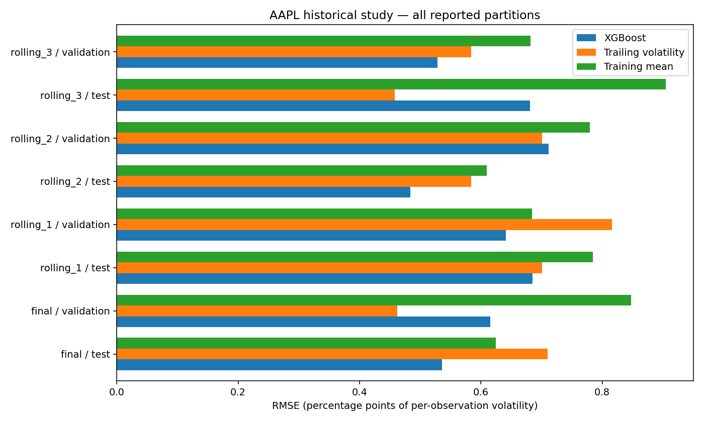

# Archived AAPL experiment — already observed

The study below was run on October 29, 2026. Its presentation was rebuilt on
October 30, 2026 without refitting the model or changing its selected settings.
It is historical methodological evidence, not a new holdout or current forecast.

- Source: pre-existing Yahoo Finance/yfinance cache, AAPL `Close`.
- Covered prices: October 24, 2018 to March 7, 2025 (1,600 observations).
- Eligible samples: 1,569; 11 price-derived features; horizon 10 observations.
- Final train: 1,055 samples, last label price February 16, 2023.
- Final validation: 242 samples, last label price February 20, 2024.
- Final test: 252 forecast origins, February 21, 2024 to February 21, 2025;
  last target price March 7, 2025.
- Final refit: 1,307 matured labels, all strictly before the first test origin.
- Selection: four XGBoost candidates × three purged inner folds; 60 trees,
  seed 42, one worker; selected maximum depth 1 and all features.

Three rolling tests and all their validations were also evaluated. Every metric
is retained in [the 24-row CSV](results/aapl_historical_metrics.csv), with the
source hashes and incomplete provenance in [the metadata](results/aapl_historical_provenance.json).
CSV errors use return fractions per observation. The figure multiplies RMSE by
100 to report percentage points. These units are not annualized.

Final-test RMSE was 0.00536072575 for XGBoost, 0.00710310479 for trailing
volatility and 0.00624810217 for the mean training target. The relative reduction
against trailing volatility was 24.53%. Final-test MAE was 0.00436826633,
0.00560973514 and 0.00529819033 respectively.

The model **lost** against trailing volatility in rolling test 3 and final
validation. The result does not establish stable superiority, alpha or a profitable
strategy. Results from adjacent dates are dependent because their labels overlap.
Changing parameters after inspecting this test would require new independent data.

## Provenance limitations

The original cache's retrieval date and price-adjustment metadata were not
certified. USD is the source's normal AAPL price convention, not independently
recorded currency metadata in that cache. The downloader requested adjusted
prices, but that alone cannot establish how this particular file was produced.
The study does not represent a survivorship-free universe or a portfolio.

No raw market cache or price series is included in this release. Redistribution
permission was not established. The complete code workflow is reproducible with
the synthetic example; exact regeneration of the archived market study would
require the same lawfully obtained, independently verified input and the original
frozen protocol. This release does not claim that the missing provenance has been
repaired. [Data contract and source terms](data-contract.md).
